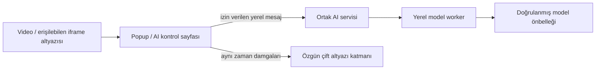

# Yerel Qwen / Local Qwen

Eklenti, **Qwen 2.5 1.5B Instruct** için ortak bir yerel motor içerir. Metin çevirisi, altyazı ve genel metin sorusu aynı bellek içi modeli kullanır. Sunucu tabanlı yapay zekâya otomatik dönüş yoktur. Küçük modelin çeviri doğruluğu ve talimat takibi sınırlıdır; sonuçlar incelenmelidir. Bu özellik geliştirici önizlemesinde deneyseldir. **CPU Türkçe çeviri doğruluk testi başarısızdır:** “The cat is sleeping.” için uint8 çıktısı “Ateş.” olmuştur. q8 denemesi de başarısızdır. Yükleme ve çevrimdışı çıkarımın çalışması, kullanışlı çeviri sağlandığı anlamına gelmez. Güvenilir çeviri tamamlanmış sayılmaz.

**Gömülü olan çalışma kodudur; model ağırlıkları XPI’nin içinde değildir.** CPU uint8 model/toplam dosyalar yaklaşık 1.59 GB, WebGPU q4f16 yaklaşık 1.23 GB indirilir. İlk indirme açık bir düğme eylemidir. Tamamlanan dosyalar eklentinin yerel CacheStorage alanında tutulur. Çevrimdışı dosya seçimi de vardır. Her dosyanın boyutu ve SHA-256 özeti doğrulanır; yarım kalan büyük dosya yeniden başlatılır. Model revizyonu ve dosya özetleri `browser/extension/ai/model.json` içindedir.

## Kullanım

1. Firefox araç çubuğundaki Fire Axolotl düğmesini aç.
2. **Yerel yapay zekâ ve altyazı** düğmesine bas.
3. İlk kullanımda **CPU / WASM** ve **Modeli indir ve cihazda yükle** seç. Bir sonraki kullanımda **İndirmeden yerel modeli yükle** yeterlidir.
4. Hazır durumu göründüğünde kaynak/hedef dili seç. Otomatik kaynak seçimi, videoda varsa altyazı dil metadata’sını kullanır; diğer metinlerde modele algılatılır.
5. Metni yazıp **Qwen ile cihazda çevir** düğmesine bas. Genel metin görevi için **Aynı modelle başka bir soru sor** bölümünü aç.
6. Video için izlediğin sekmeyi seç, oynatıcıda altyazıyı aç, **Video altyazı çevirisini aç** anahtarını etkinleştir.
7. Altyazı boyutu, fontu, renkleri, arka planı, konumu ve iki satırın görünürlüğünü aynı sayfadan ayarla. Durdurma, önceki yerel altyazı seçimini geri getirir.

Video modu standart HTML TextTrack altyazılarını okur. Bazı YouTube, Netflix ve özel oynatıcılar altyazılarını bu yolla sunmaz; bu siteler için evrensel destek iddia edilmez. Altyazısız sesi yazıya dönüştüren bir ASR modeli dahil değildir. Yavaş cihazlarda çeviri gerçek zamanın gerisinde kalabilir. VTT/SRT dosyasını önceden çevirip indirerek aynı zaman damgalarıyla oynatmak daha tutarlı olabilir. İptal/durdurma, o ana kadar hazırlanmış indirilebilir VTT çıktısını korur.

CPU için en az 8 GB kullanılabilir bellek önerilir; yükleme sırasında tarayıcının bellek sınırları ayrıca geçerlidir. WebGPU, Firefox/platform desteği ve `shader-f16` ister; bu yolun donanım doğrulaması ayrıca takip edilir. Uygulama Firefox korumalarını veya donanım bayraklarını kapatmaz. Bellekten çıkar düğmesi worker’ı kapatır, model dosyalarını korur. Sil düğmesi yalnızca model önbelleğini siler.

## Geliştirme ve doğrulama

```sh
npm ci --ignore-scripts
npm run build:ai
python3 scripts/fetch_model.py --backend wasm
python3 scripts/package_extension.py
AION_MODEL_DIR="$PWD/work/local-model" \
AION_FIREFOX_BINARY="$PWD/work/test-runtime/firefox/firefox/firefox" \
AION_GECKODRIVER="$PWD/work/test-runtime/geckodriver/geckodriver" \
.venv/bin/python tests/qwen_e2e.py
```

Üretimdeki modelin yerine test amaçlı küçük/sahte model kullanılmaz. Test, gerçek 1.5B dosyalarını arayüzden seçer; SHA-256 doğrulaması ve yerel yükleme sonrası Firefox ağını kapatır. Test kayıtları sonuç ve kalite sınırlarını ayrı belirtir; yüklemenin geçmesi tek başına iyi çeviri kanıtı değildir.



Yeni özellikler `localAI` mesajıyla `status`, `load`, `translate`, `generate`, `cancel`, `unload`, `clear` işlemlerini kullanabilir. Bunlar yalnızca açıkça izin verilen paket sayfalarından kabul edilir; web sayfalarına açık bir RPC/API değildir. Model yolu veya sürümü gelen mesajdan alınmaz. Bir seferde bir iş yürütülür; iptal worker’ı sonlandırır. Genel soru modu sekme okuma, ağ, dosya veya işlem araçlarına sahip değildir.

Transformers.js 3.7.2, ONNX Runtime Web 1.22.0 ve ilgili lisanslar paketlenir. Yükleme doğrudan doğrulanmış tokenizer JSON’u ve sabit revizyonla yapılır; çıkarımda `allowRemoteModels=false` ve ağ isteğini reddeden fetch kullanılır. WASM ve yardımcı JavaScript uzaktan çalıştırılmaz. CPU için uint8, kapalı prepacking ve bellek arena ayarları kullanılır; farklı bir model ailesiyle sessiz değişim yapılmaz.

Model: Qwen/Qwen2.5-1.5B-Instruct, Apache-2.0. ONNX dönüşümü: onnx-community, sabit commit. Lisans `ai/MODEL-LICENSE.txt`, çalışma motoru lisansları `ai/licenses/`, Eigen MPL kaynakları `scripts/fetch_ai_support.py` ile sunulur.

## English

The extension embeds a shared runtime for the actual Qwen 2.5 1.5B Instruct model. Weights are downloaded separately on explicit action or imported locally, hash checked and cached. Inference has no remote network access or cloud fallback. Translation quality is experimental. Native text-track captions and local VTT/SRT are supported; no universal streaming adapter or audio transcription is claimed. CPU needs substantial memory; WebGPU requires shader-f16 and separate platform validation. The same internal service supports future local text features without exposing tools or model execution to websites.
