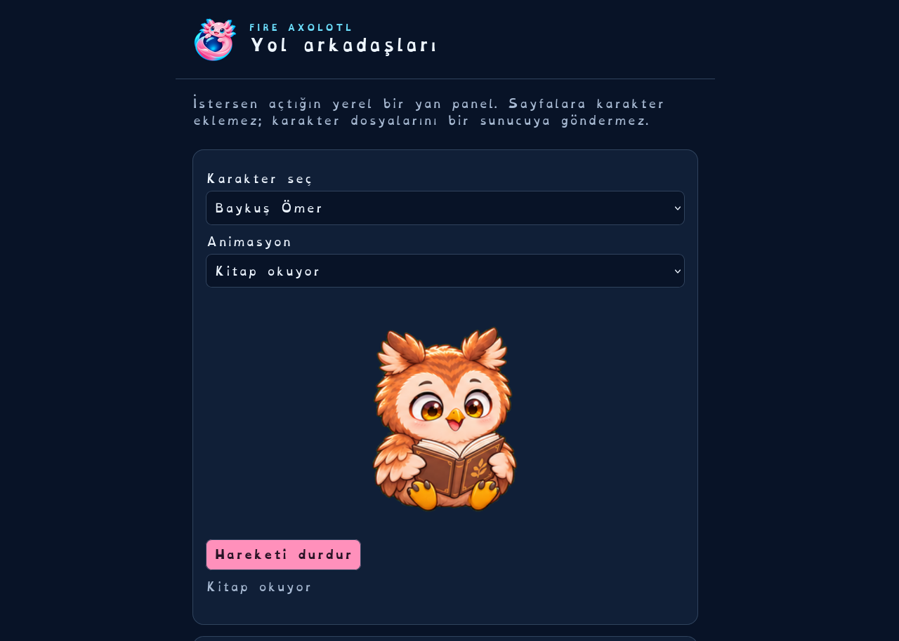
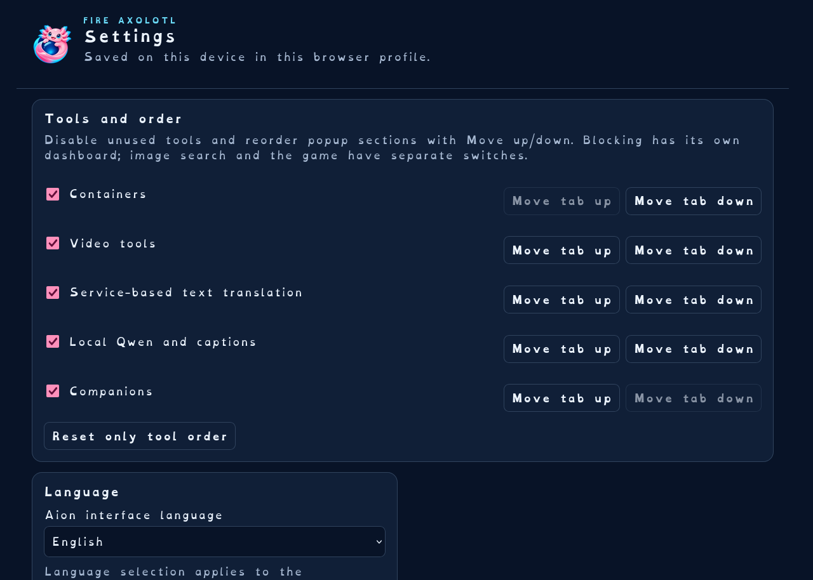
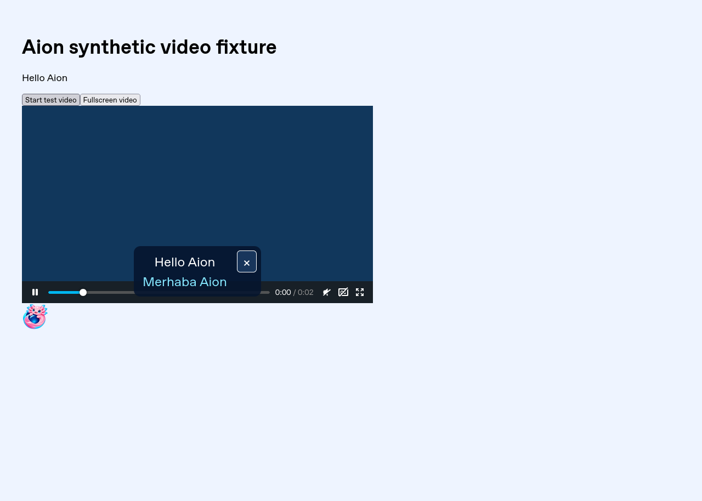
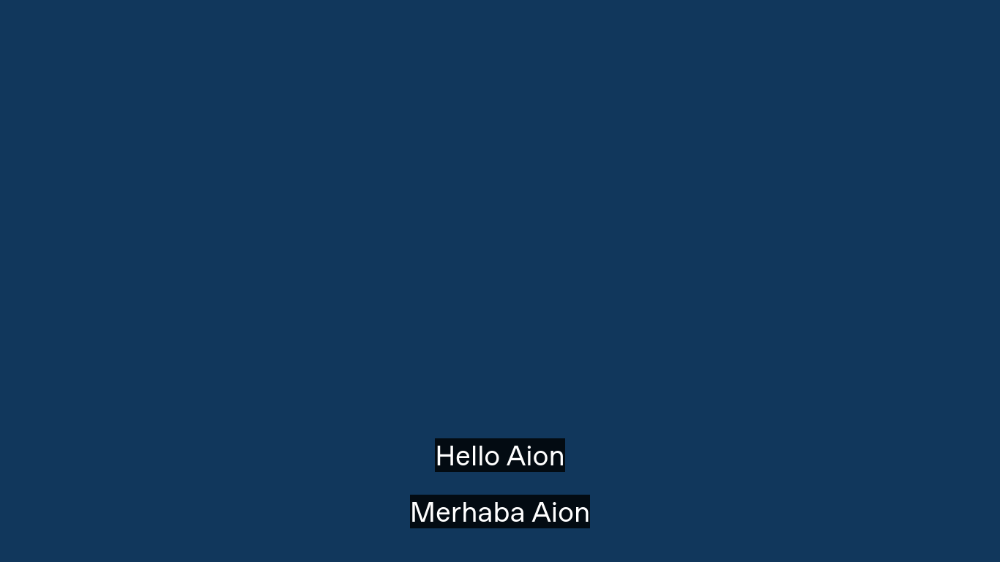
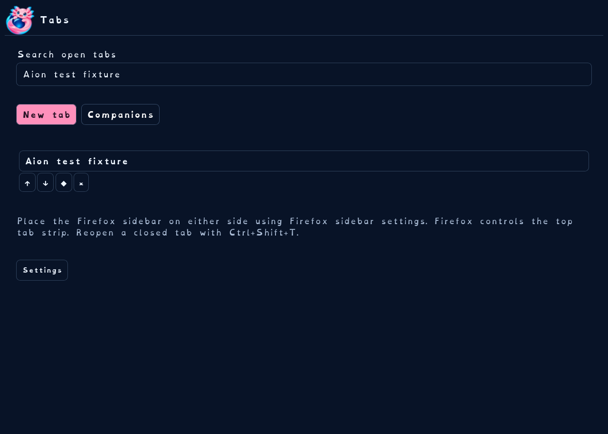
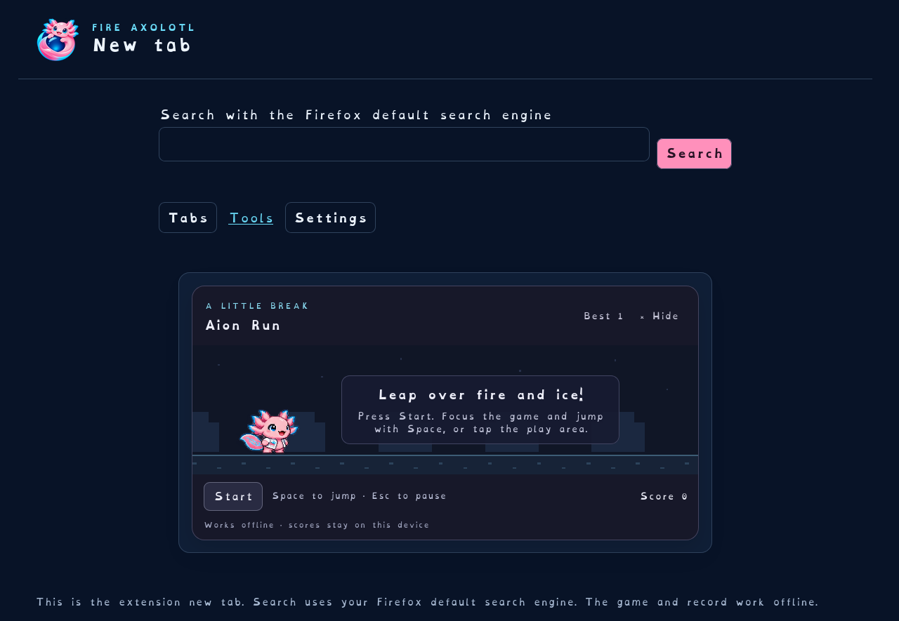
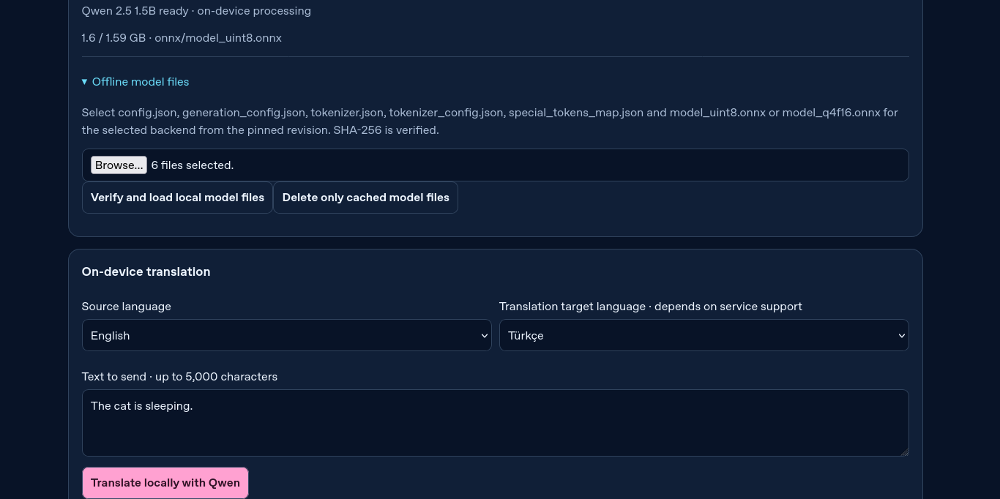
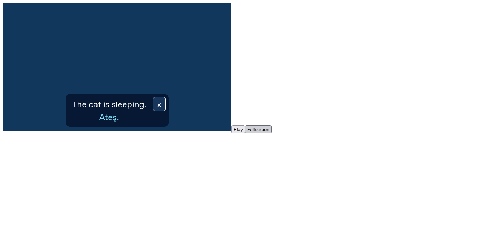

# Gerçek Firefox doğrulaması · 2026-11-10

Linux x86_64 üzerinde SHA sabitli, değiştirilmemiş Firefox ESR 153.6.0 ve geckodriver 0.37.1 kullanıldı. Tek geçici eklenti kuruldu; ayrıca uBO veya yardımcı native uygulama kurulmadı. Kişisel profil kullanılmadı. TLS doğrulaması, Firefox sandbox ve imza denetimi kapatılmadı. Geçici kurulum Firefox’un desteklenen geliştirici arayüzüyledir. Selenium dosya seçimi için yalnız ilgili dosya oluşturma otomasyon tercihi kullanılır.

| Denetim | Sonuç |
| --- | --- |
| Node birim/izin/veri doğrulama | 25 geçti |
| Gerçek Firefox ana akış | 40 geçti; [ayrıntı](evidence/firefox-results.json) |
| Firefox yeni sekmesini koruyan alternatif | 2 geçti; [ayrıntı](evidence/native-newtab-results.json) |
| JS/HTML/yerelleştirme/manifest/vendor hash | Geçti; aynı kilitli girdilerden ikinci XPI üretimi bayt bayt aynı |
| Fontlar ÇçĞğIıİiÖöŞşÜü | Üç yerel fontta geçti |
| web-ext 10.8.0 | 0 hata, 11 uyarı; [rapor](evidence/web-ext-lint.json) |
| npm audit | 0 açık; [rapor](evidence/npm-audit.json); kapsamlı güvenlik garantisi değildir |
| Gerçek Qwen 2.5 1.5B CPU | 4 teknik kontrol geçti (dosya SHA, yükleme, ağ kapalı çıkarım/altyazı, bellekten çıkarma); [rapor](evidence/qwen-results.json); **Türkçe çeviri kalite kapısı başarısız** |
| WebGPU, Windows/macOS/Android, gerçek hesapla cihazlar arası Sync | Doğrulanmadı |

Ana akışta gerçek engellenen script, konteyner, video/ses/çapraz origin iframe, yerel çift altyazı ve native tam ekran, QR çözme, site rengi/fontu, dört karakter/PNG yedeği, sekme paneli, oyun klavyesi/yerel rekor, ayar yedeği ve blocker resetinden veri koruma doğrulanır. storage.sync deneyi aynı profil alanında bir gidiş/dönüştür; iki cihaz arasında hesap deneyi değildir. Hizmet örnekleri kontrollü yerel fikstürdür; Netflix/YouTube’nun tüm sürümlerinde test anlamına gelmez.

Oyun testinde element.send_keys odak/scroll zamanlaması kararsızdı; odaklı tuvale gerçek ActionChains klavye olayıyla test düzeltildi. Modelin yerel çalışması çeviri kalitesine eşit sayılmaz. “The cat is sleeping.” cümlesinin uint8 Türkçe çıktısı “Ateş.” oldu. Önceki q8 denemesi de başarısızdı. Güvenilir çeviri açık geliştirme işidir; bu önizlemenin tamamlanmış özelliği olarak sayılmaz.

Uyarılar: uBO/Dark Reader’ın korumalı shadow-root API tespiti; uBO’nun no-eval ikame scriptleri; ONNX Emscripten globalThis eski ortam geri dönüşü ve sabit paket yollarından dinamik import; Android veri-izin alanının minimum sürüm farkı. CSP yalnız yerel script/WASM’a izin verir, unsafe-eval açılmaz. Model yolu sayfa mesajından alınmaz. Uyarılar bastırılmadı; bu rapor Mozilla imzası veya AMO onayı değildir.

## Gerçek görüntüler

Aşağıdaki görüntüler Selenium ile gerçek Firefox’tan alındı; tasarım maketi değildir. Yerel altyazı örneğindeki “Merhaba Aion” kullanıcı tarafından sağlanan test VTT metnidir; Qwen’in doğru çevirdiğine kanıt olarak kullanılmaz.

Dar ekran/200% örnekleri: [Türkçe ayarlar](evidence/settings-tr-200-narrow.png), [İngilizce karakterler](evidence/characters-en-200-narrow.png). [Yerel QR](evidence/local-qr.png) testte gerçek UTF-8 metne çözüldü.

## Deneysel modelin başarısız kalite örneği

Aşağıdaki gerçek görüntülerde modelin yanlış “Ateş.” çıktısı görülür. Bunlar kaliteli çeviri örnekleri değildir; aynı yerel çıkarımın arayüze ve zaman damgalı katmana ulaştığını gösterir.

İsteğe bağlı `Real local AI quality gate` Actions iş akışı gerçek model dosyalarını indirir ve kalite yanlışsa başarısız çıkar; sıradan CI bu büyük indirmeyi yapmaz.
