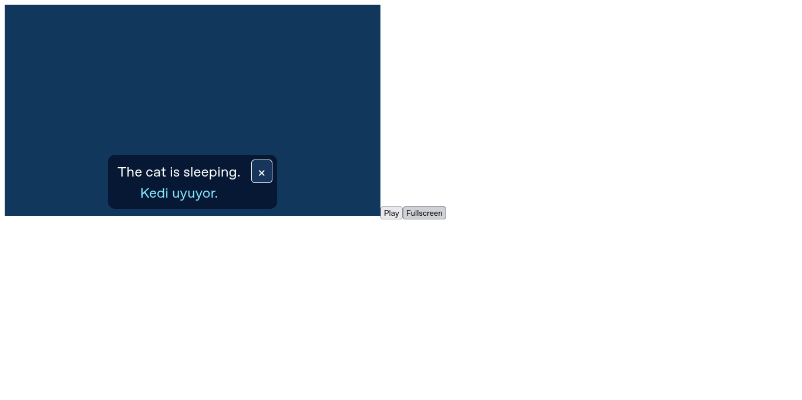
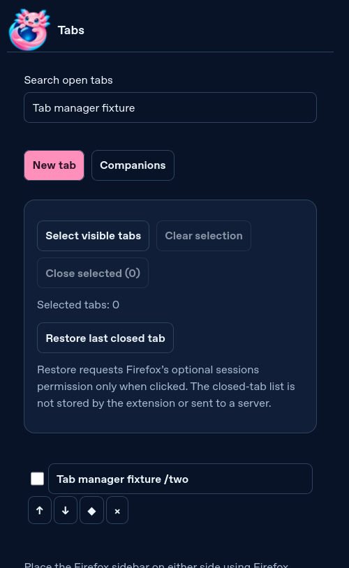
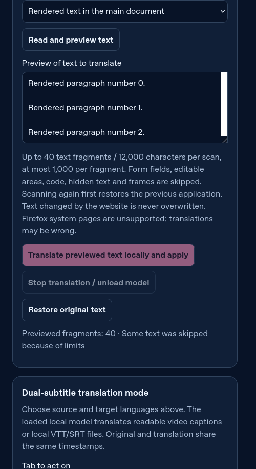
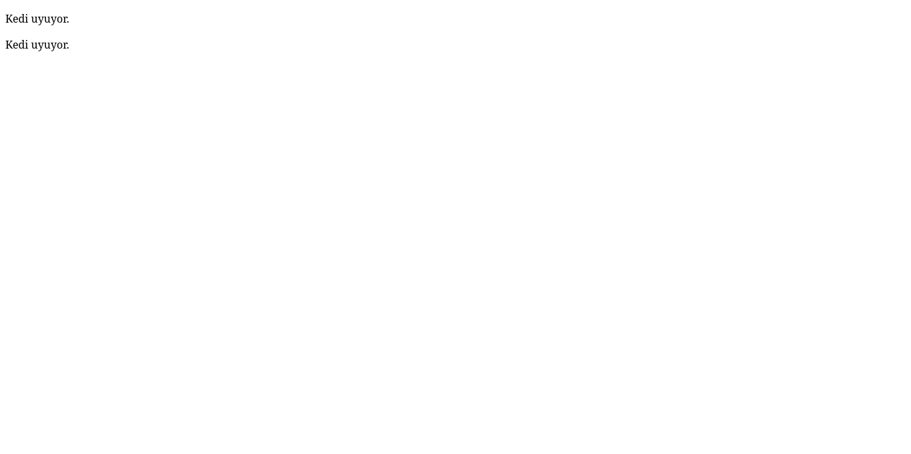
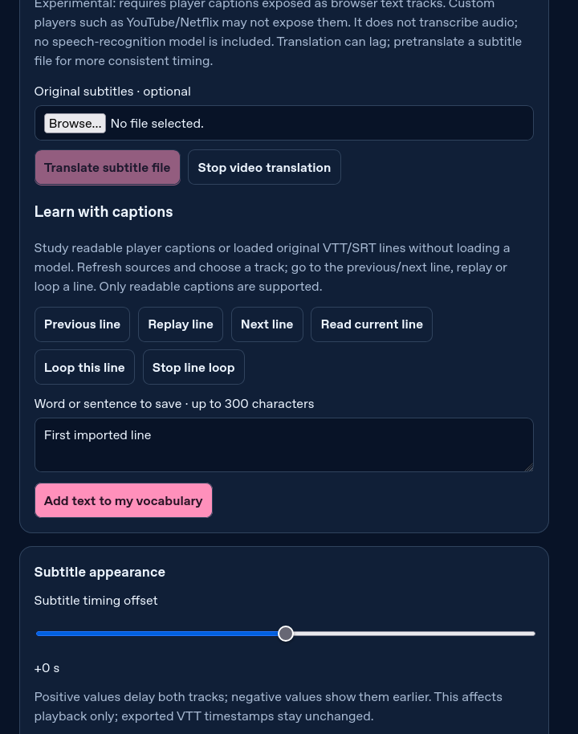

# Gerçek Firefox doğrulaması · 2026-11-10

Linux x86_64 üzerinde SHA sabitli, değiştirilmemiş Firefox ESR 153.6.0 ve geckodriver 0.37.1 kullanıldı. Tek geçici eklenti kuruldu; ayrıca uBO veya yardımcı native uygulama kurulmadı. Kişisel profil kullanılmadı. TLS doğrulaması, Firefox sandbox ve imza denetimi kapatılmadı. Geçici kurulum Firefox’un desteklenen geliştirici arayüzüyledir. Selenium dosya seçimi için yalnız ilgili dosya oluşturma otomasyon tercihi kullanılır.

| Denetim | Sonuç |
| --- | --- |
| Node birim/izin/veri doğrulama | 32 geçti |
| Gerçek Firefox ana akış | 42 geçti; [ayrıntı](evidence/firefox-results.json) |
| Firefox yeni sekmesini koruyan alternatif | 2 geçti; [ayrıntı](evidence/native-newtab-results.json) |
| 0.1.0 → 0.7.0 geliştirici yükseltmesi | 2 geçti: ayarlar, taslak, site kuralı, önbellek ve engelleyici filtresi korundu; [ayrıntı](evidence/upgrade-results.json). |
| JS/HTML/yerelleştirme/manifest/vendor hash | Geçti; aynı kilitli girdilerden ikinci XPI üretimi bayt bayt aynı |
| Fontlar ÇçĞğIıİiÖöŞşÜü | Üç yerel fontta geçti |
| web-ext 10.8.0 | 0 hata, 11 uyarı; [rapor](evidence/web-ext-lint.json) |
| npm audit | 0 açık; [rapor](evidence/npm-audit.json); kapsamlı güvenlik garantisi değildir |
| Gerçek M2M100 418M CPU · 0.7.0 | 9 teknik akış ve 4 sınırlı İngilizce/Türkçe kalite kontrolü geçti; [rapor](evidence/m2m-results.json). Ayrı indirme deneyi de geçti; [rapor](evidence/m2m-download-results.json). |
| Gerçek Qwen 2.5 1.5B CPU · 0.2.0 | 6 teknik kontrol geçti (dosya SHA, yükleme, sayfayı yeniden açma, çevrimdışı genel soru/çeviri çıktısı ve altyazı aktarımı, bellekten çıkarma); [rapor](evidence/qwen-results.json); **Türkçe çeviri kalite kapısı başarısız** |
| WebGPU, Windows/macOS/Android, gerçek hesapla cihazlar arası Sync | Doğrulanmadı |

Ana akışta gerçek engellenen script, konteyner, video/ses/çapraz origin iframe, yerel çift altyazı ve native tam ekran, QR çözme, site rengi/fontu, dört karakter/PNG yedeği, sekme paneli, oyun klavyesi/yerel rekor, ayar yedeği ve blocker resetinden veri koruma doğrulanır. storage.sync deneyi aynı profil alanında bir gidiş/dönüştür; iki cihaz arasında hesap deneyi değildir. Hizmet örnekleri kontrollü yerel fikstürdür; Netflix/YouTube’nun tüm sürümlerinde test anlamına gelmez.

Oyun testinde element.send_keys odak/scroll zamanlaması kararsızdı; odaklı tuvale gerçek ActionChains klavye olayıyla ve güvenli atlayış aralığında daraltılmış bir beklemeyle test düzeltildi. CI’nin önceki denemesinde geniş aralık erken zıplamaya neden olabildi; başarısız koşular Actions geçmişinde korunur. Ayar sayfası işlemleri, arayüz dinleyicilerinin hazır işaretini bekler; HTML’nin görünmesi tek başına etkileşim hazırlığı sayılmaz. Modelin yerel çalışması çeviri kalitesine eşit sayılmaz. “The cat is sleeping.” cümlesinin uint8 Türkçe çıktısı “Ateş.” oldu. Önceki q8 denemesi de başarısızdı. Güvenilir çeviri açık geliştirme işidir; bu önizlemenin tamamlanmış özelliği olarak sayılmaz.

Uyarılar: uBO/Dark Reader’ın korumalı shadow-root API tespiti; uBO’nun no-eval ikame scriptleri; ONNX Emscripten globalThis eski ortam geri dönüşü ve sabit paket yollarından dinamik import; Android veri-izin alanının minimum sürüm farkı. CSP yalnız yerel script/WASM’a izin verir, unsafe-eval açılmaz. Model yolu sayfa mesajından alınmaz. Uyarılar bastırılmadı; bu rapor Mozilla imzası veya AMO onayı değildir.

## Gerçek görüntüler

Aşağıdaki görüntüler Selenium ile gerçek Firefox’tan alındı; tasarım maketi değildir. Yerel altyazı örneğindeki “Merhaba Aion” kullanıcı tarafından sağlanan test VTT metnidir; Qwen’in doğru çevirdiğine kanıt olarak kullanılmaz.

Dar ekran/200% örnekleri: [Türkçe ayarlar](evidence/settings-tr-200-narrow.png), [İngilizce karakterler](evidence/characters-en-200-narrow.png). [Yerel QR](evidence/local-qr.png) testte gerçek UTF-8 metne çözüldü.

## Deneysel modelin başarısız kalite örneği

Aşağıdaki gerçek görüntülerde modelin yanlış “Ateş.” çıktısı görülür. Bunlar kaliteli çeviri örnekleri değildir; aynı yerel çıkarımın arayüze ve zaman damgalı katmana ulaştığını gösterir.

İsteğe bağlı `Real local AI quality gate` Actions iş akışı gerçek model dosyalarını indirir ve kalite yanlışsa başarısız çıkar; sıradan CI bu büyük indirmeyi yapmaz.

## 0.2.0: M2M100 yerel çeviri

Gerçek 640 MB model önce kullanıcı dosya seçicisiyle, ayrıca eklentinin indirme düğmesiyle yüklendi ve SHA-256 ile doğrulandı. İndirme testi bu yönetilen ortamdaki proxy ve sağlanan CA’yı geçici Firefox profiline kullandı; TLS doğrulaması açık kaldı. Model yüklendikten sonra Firefox ağı kapatıldı. `The cat is sleeping.` → `Kedi uyuyor.`, aynı cümlede otomatik kaynak seçimi ve `Merhaba, nasılsın?` → `Hello, how are you?` geçti. Video örneğinde iki altyazının zamanları eşleşti ve durdurunca eski altyazı geri geldi. Yerel VTT dosyası çevrilip orijinal zamanlarıyla dışa aktarıldı.

**Bilinen kalite hatası:** Kullanıcının örneği `I was about to give up.` → `Ben vazgeçmeye hazırım.` çıktı. Bu sonuç geçmişteki niyet/zaman anlamını korumuyor. Bu yüzden bu örnek güvenilir çeviri sayılmaz. Üç basit kontrol modelin bütün cümlelerde veya 100 dilin tamamında doğru olduğunu göstermez; insan incelemesi gerekir.

Ağ açılmadan yerel dosyadan içe aktarma ve açık indirme eylemi ayrı denendi. Otomatik kaynak dil tespiti, Firefox güvenilir bulmazsa kaynak dilin kullanıcı tarafından seçilmesini ister. Qwen 0.2.0’da genel soru için de çevrimdışı çıktı üretti; yanıtın kalitesi bu testte derecelendirilmedi. Türkçe kalite kontrolü yine başarısızdı.

Yükseltme deneyi aynı eklenti kimliğiyle doğrulanmış 0.1.0 XPI’sinden 0.2.0 geçici kurulumuna yapılmıştır. Bu, imzalı AMO güncellemesi veya Firefox yeniden başlatılınca kalıcı kurulum testi değildir. Önbellek kontrolünde küçük bir CacheStorage örneği kullanıldı; büyük model dosyasının kendisiyle ayrı yükseltme testi yapılmadı. Test sırasında diğer normal sekme açık tutulmuştur; Firefox eski eklenti sayfasını yükseltirken kapatır.

## 0.3.0: altyazı senkronu ve eski işlem yalıtımı

Pozitif gecikmede DOM katmanının doğru anda göründüğü ve iki yerel izin aynı başlangıç/bitişe kaydığı gerçek Firefox’ta doğrulandı. Negatif kaydırmada sıfırdan önceki başlangıçlar kırpıldı, tamamen geçmiş satırlar kaldırıldı; sıfırla düğmesi ayarı geri aldı. Birim testleri aynı tür model yeniden yüklense bile eski dil algılamasının ve eski worker mesajının yeni oturumu değiştiremediğini doğrular.

## 0.4.0: altyazıyla öğrenme

Gerçek Firefox’ta, AI modeli yüklenmeden satırı tekrar oynatma, önceki/sonraki satıra gitme, satırı kelime defterine kaydetme ve gecikme varken güncel satırı okuma doğrulandı. Son satırdan sonra ileri gitme girişimi oynatma zamanını değiştirmedi. Yeni akış yalnız erişilebilir yerel video altyazısına uygulanır; çeviri kalitesinde veya özel hizmet altyazı erişiminde iyileşme iddiası yoktur.

## 0.5.0: sekme yönetimi

Gerçek Firefox testinde görünür sekmeleri seçme, filtre değişince seçimi temizleme, toplu kapatmayı iptal etme ve onaylayarak kapatma doğrulandı. İlgisiz sekmeler korundu. Firefox izin penceresinde Deny/Allow kararları, pencere odağı ve Firefox’un güvenlik gecikmesi korunarak otomatik tetiklendi; izin reddi erişim vermedi, izin verme bir kapanmış sekmeyi geri açtı, izin kaldırma erişimi geri çekti. WebDriver’ın açılır pencere kaydırma sınırlaması nedeniyle native izin düğmelerinin kendi click olayları kullanıldı; izin veritabanı değiştirilmedi ve güvenlik gecikmesi kapatılmadı. [Rapor](evidence/tab-manager-results.json). Bu test gerçek hesap Sync veya imzalı güncelleme testi değildir.

## 0.6.0: önizlenen sayfa ve web diyaloğu çevirisi

[DOM uygulama raporu](evidence/page-translation-results.json), normal AI arayüzünde sayfa/açık web diyaloğu önizlemesini ve model olmadan uygula düğmesinin kapalı kaldığını doğrular. Gizli, tamamen saydam, düzenlenebilir, form, kod ve iframe metni alınmadı. Sabit çeviri dizeleriyle HTML olarak yorumlanmayan metin uygulaması, DOM olaylarının ve parola/form değerlerinin korunması, site güncellemelerinin ezilmemesi, tarama/gezinme sonrası eski token reddi, 40 parça sınırı ve AI kapalıyken geri alma sınandı. Bu sabit dizeler model doğruluğu testi sayılmaz.

Ayrı [gerçek M2M100 raporunda](evidence/m2m-results.json), hash doğrulanmış model Firefox içinde yüklendi; ağ kapatıldıktan sonra normal AI ekranındaki önizle/çevir/geri al düğmeleriyle ana sayfa ve web diyaloğundaki `The cat is sleeping.` → `Kedi uyuyor.` doğrulandı. Aynı metin bir taramada tekrar kullanıldı. Önceki İngilizce/Türkçe metin, otomatik algılama, çift video altyazısı ve VTT kontrolleri de geçti. Bilinen `I was about to give up.` anlam/zaman hatası aynen sürüyor. Bu örnekler tüm sitelerde veya 100 dilde kalite onayı değildir.

0.6.0 elle sürüm kontrolü testinde yayımlanmış önizlemenin seçilmesi, taslakların ve geçersiz etiketlerin dışlanması, boş liste/hatalı API yanıtı ve yalnız proje GitHub sürüm adresinin kullanılması doğrulandı. GitHub’ın `/releases/latest` uç noktası yalnız önizleme bulunan bu depoda gerçekten 404 döndürüyordu; liste API’sine geçildi. Bu bir otomatik kurulum veya imza doğrulama testi değildir.

## 0.7.0: satır döngüsü ve dosya altyazısıyla öğrenme

[Gerçek Firefox raporu](evidence/caption-learning-results.json) altı akışı doğrular: model olmadan kaynak seçimi/native satır döngüsü ve normal duraklatma; elle başka zamana gidince çıkış; hızlı başlat/durdurda geç kalmış döngünün çalışmaması; video süresini aşan son satırda gerçek medya bitişinden tekrar ve önceki tam-video döngü ayarının geri gelmesi; popup’ın gerçek SRT dosya seçicisiyle yüklenen kaynağında okuma/gezinme/kelime ve gecikme; panel kapanınca dosya döngüsü/katmanın temizlenip oynatıcı altyazısının geri gelmesi. Testte zaman konumu açıkça seçilir; önceki iki denemede akmakta olan videonun konumuna bağlı gecikme varsayımı başarısızdı ve düzeltilmiştir.

İki yeni birim testi, bir sekmedeki bekleyen medya başlangıcından sonra gelen temizlemenin sırasını, diğer sekmenin bağımsızlığını ve başarısız başlangıçtan sonra temizleme/sonraki denetimlerin çalışmasını doğrular. Ayrı gerçek M2M100 çevrimdışı deneyinde özgün satır katmanda gizliyken de dosya öğrenme kaynağından okunabildi. Önceki dört sınırlı metin kalite kontrolü geçti; bilinen anlam/zaman hatası sürüyor.

Qwen [tanı denemeleri](evidence/qwen-diagnostics-0.7.json) farklı komutların ve sabit upstream LFS SHA-256 ile doğrulanmış q4 dosyasının Türkçe hatasını çözmediğini gösterir. Native CPU ve Firefox deneylerinde sistem komutları farklı olduğundan bu tek başına hatalı katmanı yalıtmaz. q4 ürüne eklenmedi, başarısız sonuçlar gizlenmedi. Bu denemeler kapsamlı dil ölçümü değildir.

0.7.0’ın ilk CI koşusu [42817434523](https://github.com/kaansavukduran/fire-axolotl-extension/actions/runs/42817434523), popup’ta metin görünürken dinleyiciler henüz bağlanmadan konteyner formuna tıklama yarışı nedeniyle durdu. Popup başlangıçta `inert`/`aria-busy` olur; hazırlık tamamlanınca açılır. Testler placeholder/başlık yerine gerçek `data-ready` işaretini bekler. Düzeltmeden sonra yerel ana akışın 42 kontrolü ve gerçek 0.1.0→0.7.0 yükseltmesi geçti. İlk başarısız koşu korunur; bu olay yeni altyazı testinden önceydi.
