# Gerçek Firefox doğrulaması · 2026-11-10

Linux x86_64 üzerinde SHA sabitli, değiştirilmemiş Firefox ESR 153.6.0 ve geckodriver 0.37.1 kullanıldı. Tek geçici eklenti kuruldu; ayrıca uBO veya yardımcı native uygulama kurulmadı. Kişisel profil kullanılmadı. TLS doğrulaması, Firefox sandbox ve imza denetimi kapatılmadı. Geçici kurulum Firefox’un desteklenen geliştirici arayüzüyledir. Selenium dosya seçimi için yalnız ilgili dosya oluşturma otomasyon tercihi kullanılır.

| Denetim | Sonuç |
| --- | --- |
| Node birim/izin/veri doğrulama | 51 geçti |
| Gerçek popup, geniş panel, sağ tık konteyner ve AI başlangıcı · 0.11.0 | 6 geçti; [rapor](evidence/usability-results.json). |
| Aion runtime simgesi ve YouTube biçiminde yerel HTTPS oyuncu · 0.12.0 | 5 geçti; [kapsam ve rapor](evidence/youtube-results.json). Gerçek kamu videosuna erişim 403 ile engellendi. |
| Gerçek Firefox ana akış | 42 geçti; [ayrıntı](evidence/firefox-results.json) |
| Firefox yeni sekmesini koruyan alternatif | 2 geçti; [ayrıntı](evidence/native-newtab-results.json) |
| 0.1.0 → 0.12.0 geliştirici yükseltmesi | 2 geçti: ayarlar, eski Unicode/tekrar/boşluk içeren kelimeler, taslak, site kuralı, önbellek ve engelleyici filtresi korundu; [ayrıntı](evidence/upgrade-results.json). |
| JS/HTML/yerelleştirme/manifest/vendor hash | Geçti; aynı kilitli girdilerden ikinci XPI üretimi bayt bayt aynı |
| Fontlar ÇçĞğIıİiÖöŞşÜü | Üç yerel fontta geçti |
| Gerçek kelime defteri · 0.10.0 | 6 geçti; [rapor](evidence/wordbook-results.json). |
| web-ext 10.8.0 | 0 hata, 11 uyarı; [rapor](evidence/web-ext-lint.json) |
| npm audit | 0 açık; [rapor](evidence/npm-audit.json); kapsamlı güvenlik garantisi değildir |
| Gerçek M2M100 418M CPU · 0.8.0 | 9 teknik akış ve 4 sınırlı İngilizce/Türkçe kalite kontrolü geçti; [rapor](evidence/m2m-results.json). Ayrı indirme deneyi de geçti; [rapor](evidence/m2m-download-results.json). |
| Gerçek Qwen 2.5 1.5B CPU · 0.2.0 | 6 teknik kontrol geçti (dosya SHA, yükleme, sayfayı yeniden açma, çevrimdışı genel soru/çeviri çıktısı ve altyazı aktarımı, bellekten çıkarma); [rapor](evidence/qwen-results.json); **Türkçe çeviri kalite kapısı başarısız** |
| WebGPU, Windows/macOS/Android, gerçek hesapla cihazlar arası Sync | Doğrulanmadı |

Ana akışta gerçek engellenen script, konteyner, video/ses/çapraz origin iframe, yerel çift altyazı ve native tam ekran, QR çözme, site rengi/fontu, dört karakter/PNG yedeği, sekme paneli, oyun klavyesi/yerel rekor, ayar yedeği ve blocker resetinden veri koruma doğrulanır. storage.sync deneyi aynı profil alanında bir gidiş/dönüştür; iki cihaz arasında hesap deneyi değildir. Hizmet örnekleri kontrollü yerel fikstürdür; Netflix/YouTube’nun tüm sürümlerinde test anlamına gelmez.

Oyun testinde element.send_keys odak/scroll zamanlaması kararsızdı; odaklı tuvale gerçek ActionChains klavye olayıyla ve güvenli atlayış aralığında daraltılmış bir beklemeyle test düzeltildi. CI’nin önceki denemesinde geniş aralık erken zıplamaya neden olabildi; başarısız koşular Actions geçmişinde korunur. Ayar sayfası işlemleri, arayüz dinleyicilerinin hazır işaretini bekler; HTML’nin görünmesi tek başına etkileşim hazırlığı sayılmaz. Modelin yerel çalışması çeviri kalitesine eşit sayılmaz. “The cat is sleeping.” cümlesinin uint8 Türkçe çıktısı “Ateş.” oldu. Önceki q8 denemesi de başarısızdı. Güvenilir çeviri açık geliştirme işidir; bu önizlemenin tamamlanmış özelliği olarak sayılmaz.

Uyarılar: uBO/Dark Reader’ın korumalı shadow-root API tespiti; uBO’nun no-eval ikame scriptleri; ONNX Emscripten globalThis eski ortam geri dönüşü ve sabit paket yollarından dinamik import; Android veri-izin alanının minimum sürüm farkı. CSP yalnız yerel script/WASM’a izin verir, unsafe-eval açılmaz. Model yolu sayfa mesajından alınmaz. Uyarılar bastırılmadı; bu rapor Mozilla imzası veya AMO onayı değildir.

## Gerçek görüntüler

Aşağıdaki görüntüler Selenium ile gerçek Firefox’tan alındı; tasarım maketi değildir. Yerel altyazı örneğindeki “Merhaba Aion” kullanıcı tarafından sağlanan test VTT metnidir; Qwen’in doğru çevirdiğine kanıt olarak kullanılmaz.

Dar ekran/200% örnekleri: [Türkçe ayarlar](evidence/settings-tr-200-narrow.png), [İngilizce karakterler](evidence/characters-en-200-narrow.png). [Yerel QR](evidence/local-qr.png) testte gerçek UTF-8 metne çözüldü.

## Deneysel modelin başarısız kalite örneği

Aşağıdaki gerçek görüntülerde modelin yanlış “Ateş.” çıktısı görülür. Bunlar kaliteli çeviri örnekleri değildir; aynı yerel çıkarımın arayüze ve zaman damgalı katmana ulaştığını gösterir.

İsteğe bağlı `Real local AI quality gate` Actions iş akışı gerçek model dosyalarını indirir ve kalite yanlışsa başarısız çıkar; sıradan CI bu büyük indirmeyi yapmaz.

## 0.2.0: M2M100 yerel çeviri

Gerçek 640 MB model önce kullanıcı dosya seçicisiyle, ayrıca eklentinin indirme düğmesiyle yüklendi ve SHA-256 ile doğrulandı. İndirme testi bu yönetilen ortamdaki proxy ve sağlanan CA’yı geçici Firefox profiline kullandı; TLS doğrulaması açık kaldı. Model yüklendikten sonra Firefox ağı kapatıldı. `The cat is sleeping.` → `Kedi uyuyor.`, aynı cümlede otomatik kaynak seçimi ve `Merhaba, nasılsın?` → `Hello, how are you?` geçti. Video örneğinde iki altyazının zamanları eşleşti ve durdurunca eski altyazı geri geldi. Yerel VTT dosyası çevrilip orijinal zamanlarıyla dışa aktarıldı.

**Bilinen kalite hatası:** Kullanıcının örneği `I was about to give up.` → `Ben vazgeçmeye hazırım.` çıktı. Bu sonuç geçmişteki niyet/zaman anlamını korumuyor. Bu yüzden bu örnek güvenilir çeviri sayılmaz. Üç basit kontrol modelin bütün cümlelerde veya 100 dilin tamamında doğru olduğunu göstermez; insan incelemesi gerekir.

Ağ açılmadan yerel dosyadan içe aktarma ve açık indirme eylemi ayrı denendi. Otomatik kaynak dil tespiti, Firefox güvenilir bulmazsa kaynak dilin kullanıcı tarafından seçilmesini ister. Qwen 0.2.0’da genel soru için de çevrimdışı çıktı üretti; yanıtın kalitesi bu testte derecelendirilmedi. Türkçe kalite kontrolü yine başarısızdı.

Yükseltme deneyi aynı eklenti kimliğiyle doğrulanmış 0.1.0 XPI’sinden 0.2.0 geçici kurulumuna yapılmıştır. Bu, imzalı AMO güncellemesi veya Firefox yeniden başlatılınca kalıcı kurulum testi değildir. Önbellek kontrolünde küçük bir CacheStorage örneği kullanıldı; büyük model dosyasının kendisiyle ayrı yükseltme testi yapılmadı. Test sırasında diğer normal sekme açık tutulmuştur; Firefox eski eklenti sayfasını yükseltirken kapatır.

## 0.3.0: altyazı senkronu ve eski işlem yalıtımı

Pozitif gecikmede DOM katmanının doğru anda göründüğü ve iki yerel izin aynı başlangıç/bitişe kaydığı gerçek Firefox’ta doğrulandı. Negatif kaydırmada sıfırdan önceki başlangıçlar kırpıldı, tamamen geçmiş satırlar kaldırıldı; sıfırla düğmesi ayarı geri aldı. Birim testleri aynı tür model yeniden yüklense bile eski dil algılamasının ve eski worker mesajının yeni oturumu değiştiremediğini doğrular.

## 0.4.0: altyazıyla öğrenme

Gerçek Firefox’ta, AI modeli yüklenmeden satırı tekrar oynatma, önceki/sonraki satıra gitme, satırı kelime defterine kaydetme ve gecikme varken güncel satırı okuma doğrulandı. Son satırdan sonra ileri gitme girişimi oynatma zamanını değiştirmedi. Yeni akış yalnız erişilebilir yerel video altyazısına uygulanır; çeviri kalitesinde veya özel hizmet altyazı erişiminde iyileşme iddiası yoktur.

## 0.5.0: sekme yönetimi

Gerçek Firefox testinde görünür sekmeleri seçme, filtre değişince seçimi temizleme, toplu kapatmayı iptal etme ve onaylayarak kapatma doğrulandı. İlgisiz sekmeler korundu. Firefox izin penceresinde Deny/Allow kararları, pencere odağı ve Firefox’un güvenlik gecikmesi korunarak otomatik tetiklendi; izin reddi erişim vermedi, izin verme bir kapanmış sekmeyi geri açtı, izin kaldırma erişimi geri çekti. WebDriver’ın açılır pencere kaydırma sınırlaması nedeniyle native izin düğmelerinin kendi click olayları kullanıldı; izin veritabanı değiştirilmedi ve güvenlik gecikmesi kapatılmadı. [Rapor](evidence/tab-manager-results.json). Bu test gerçek hesap Sync veya imzalı güncelleme testi değildir.

## 0.6.0: önizlenen sayfa ve web diyaloğu çevirisi

[DOM uygulama raporu](evidence/page-translation-results.json), normal AI arayüzünde sayfa/açık web diyaloğu önizlemesini ve model olmadan uygula düğmesinin kapalı kaldığını doğrular. Gizli, tamamen saydam, düzenlenebilir, form, kod ve iframe metni alınmadı. Sabit çeviri dizeleriyle HTML olarak yorumlanmayan metin uygulaması, DOM olaylarının ve parola/form değerlerinin korunması, site güncellemelerinin ezilmemesi, tarama/gezinme sonrası eski token reddi, 40 parça sınırı ve AI kapalıyken geri alma sınandı. Bu sabit dizeler model doğruluğu testi sayılmaz.

Ayrı [gerçek M2M100 raporunda](evidence/m2m-results.json), hash doğrulanmış model Firefox içinde yüklendi; ağ kapatıldıktan sonra normal AI ekranındaki önizle/çevir/geri al düğmeleriyle ana sayfa ve web diyaloğundaki `The cat is sleeping.` → `Kedi uyuyor.` doğrulandı. Aynı metin bir taramada tekrar kullanıldı. Önceki İngilizce/Türkçe metin, otomatik algılama, çift video altyazısı ve VTT kontrolleri de geçti. Bilinen `I was about to give up.` anlam/zaman hatası aynen sürüyor. Bu örnekler tüm sitelerde veya 100 dilde kalite onayı değildir.

0.6.0 elle sürüm kontrolü testinde yayımlanmış önizlemenin seçilmesi, taslakların ve geçersiz etiketlerin dışlanması, boş liste/hatalı API yanıtı ve yalnız proje GitHub sürüm adresinin kullanılması doğrulandı. GitHub’ın `/releases/latest` uç noktası yalnız önizleme bulunan bu depoda gerçekten 404 döndürüyordu; liste API’sine geçildi. Bu bir otomatik kurulum veya imza doğrulama testi değildir.

## 0.7.0: satır döngüsü ve dosya altyazısıyla öğrenme

[Gerçek Firefox raporu](evidence/caption-learning-results.json) altı akışı doğrular: model olmadan kaynak seçimi/native satır döngüsü ve normal duraklatma; elle başka zamana gidince çıkış; hızlı başlat/durdurda geç kalmış döngünün çalışmaması; video süresini aşan son satırda gerçek medya bitişinden tekrar ve önceki tam-video döngü ayarının geri gelmesi; popup’ın gerçek SRT dosya seçicisiyle yüklenen kaynağında okuma/gezinme/kelime ve gecikme; panel kapanınca dosya döngüsü/katmanın temizlenip oynatıcı altyazısının geri gelmesi. Testte zaman konumu açıkça seçilir; önceki iki denemede akmakta olan videonun konumuna bağlı gecikme varsayımı başarısızdı ve düzeltilmiştir.

İki yeni birim testi, bir sekmedeki bekleyen medya başlangıcından sonra gelen temizlemenin sırasını, diğer sekmenin bağımsızlığını ve başarısız başlangıçtan sonra temizleme/sonraki denetimlerin çalışmasını doğrular. Ayrı gerçek M2M100 çevrimdışı deneyinde özgün satır katmanda gizliyken de dosya öğrenme kaynağından okunabildi. Önceki dört sınırlı metin kalite kontrolü geçti; bilinen anlam/zaman hatası sürüyor.

Qwen [tanı denemeleri](evidence/qwen-diagnostics-0.7.json) farklı komutların ve sabit upstream LFS SHA-256 ile doğrulanmış q4 dosyasının Türkçe hatasını çözmediğini gösterir. Native CPU ve Firefox deneylerinde sistem komutları farklı olduğundan bu tek başına hatalı katmanı yalıtmaz. q4 ürüne eklenmedi, başarısız sonuçlar gizlenmedi. Bu denemeler kapsamlı dil ölçümü değildir.

0.7.0’ın ilk CI koşusu [42817434523](https://github.com/kaansavukduran/fire-axolotl-extension/actions/runs/42817434523), popup’ta metin görünürken dinleyiciler henüz bağlanmadan konteyner formuna tıklama yarışı nedeniyle durdu. Popup başlangıçta `inert`/`aria-busy` olur; hazırlık tamamlanınca açılır. Testler placeholder/başlık yerine gerçek `data-ready` işaretini bekler. Düzeltmeden sonra yerel ana akışın 42 kontrolü ve gerçek 0.1.0→0.7.0 yükseltmesi geçti. İlk başarısız koşu korunur; bu olay yeni altyazı testinden önceydi.

## 0.8.0: motor ve modeller XPI içinde, ilk kullanım çevrimdışı

[Bergamot gerçek Firefox raporu](evidence/bergamot-results.json): yalnız birleşik XPI kuruldu. Firefox ağı ilk AI ekranı ve ilk model worker’ı açılmadan önce kapatıldı. Popup’ın gerçek yerel çeviri düğmesi, ayrıca model indirme/dosya seçimi veya model CacheStorage’ı olmadan `The cat is sleeping.` → `Kedi uyuyor.` üretti. İki dil yönü, yerel otomatik algılama ve desteklenmeyen dilde açık hata; normal sayfa/web diyaloğu önizle-çevir-geri al; gerçek çift video altyazısı ve native video tam ekranında eş zamanlar; gerçek VTT dosyasında aynı dışa aktarma zamanları; worker’ı bellekten çıkarma ve ayrı Qwen seçimi geçti. Beş dar metin kontrolü geçti; bunlar bütün dil kullanımının kalite onayı değildir.

Ters örnekte `Hi, how are you?` doğru çıktısı, ilk dar denetimin yalnız `Hello` sözcüğünü kabul etmesi nedeniyle yanlışlıkla başarısız sayılmıştı; denetim iki geçerli selamlamayı kabul edecek şekilde düzeltildi. **Gerçek bilinen hata korunur:** `I was about to give up.` → `- Vermek için çok ilgiliydim.` deyimin anlamını kaybeder. Bu sonuç kalite geçişi sayılmaz.

Başlangıç hatası ayrı sınandı: Firefox offline modunda ana eklenti bağlamından aynı paket WASM’ı okunurken classic worker `fetch` isteği `NetworkError` verdi. Paket byte’ları ana bağlamdan aktarılıp worker’da WASM/model SHA-256’sı doğrulanarak düzeltildi; ağ/TLS/sandbox/imza denetimi gevşetilmedi. Worker çıkarımındaki fetch yalnız aktarılmış in-memory asset yanıtları verebilir. Dört yeni birim testi varsayılan paket motoru için yükleme/çeviri, desteklenmeyen dil, iptal/eskimiş callback, veri aktarımı başlamadan hazırlığı iptal ve boş/uzun metnin worker oluşturmadan reddini kapsar.

Ayrı M2M100 regresyonunda dokuz teknik akış ve dört sınırlı kalite kontrolü yine geçti; eski anlam/zaman hatası değişmedi. Qwen’in önceki Türkçe başarısızlığı çözülmüş sayılmaz. Windows/macOS/Android ve WebGPU doğrulaması eklenmedi.

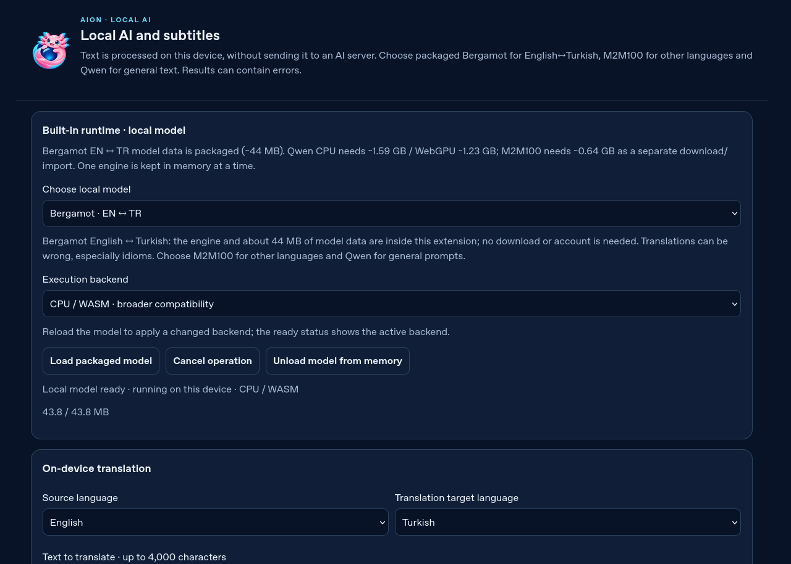

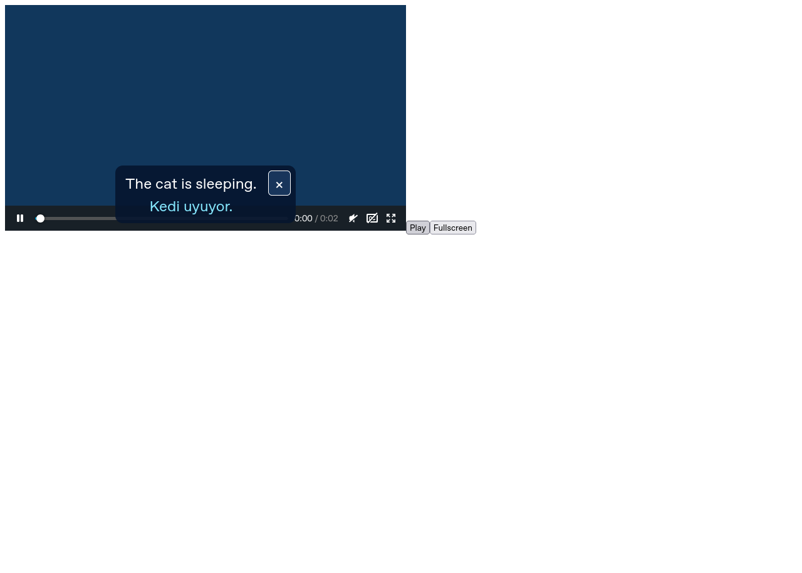

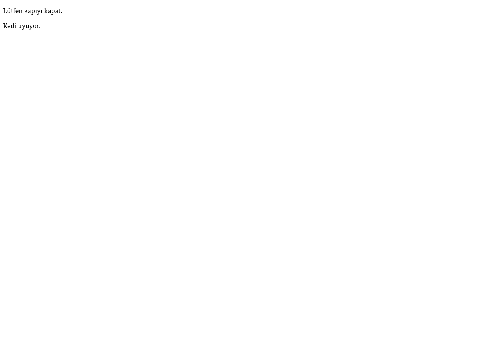

## 0.9.0: video üzerindeki kelime kartı

[Gerçek Firefox raporu](evidence/caption-card-results.json) beş akışı doğrular: açık öğrenme düğmesi videoyu durdurur, kapalı shadow ve gerçek kullanıcı olayı gereksinimi sayfa/script tıklamasıyla otomatik çıkarımı engeller; ağ zaten kapalıyken gerçek paket Bergamot motoru cümleyi ve `cat` → `Kedi` kelimesini çevirir, iki kaydetme tek kayıt oluşturur; canlı katman yenilenirken kart/yanıt korunur, Escape duraklatılmış bırakır ve açık devam düğmesi oynatır; kesme işareti/Türkçe kelime seçimi, HTML’nin düz metin kalması ve açık kartta modül kapatılması; TR kontrolü ve erişilebilir iframe çevirisi, iki frame’in de açık durdurmada temizlenmesi. Klavyeyle kelime seçimi ve dar ekran görünümü de aynı deneyde sınandı. HTML oynatıcı kapsayıcısı tam ekranı kartı korur; native video tam ekranı yalnız altyazı gösterebilir.

Dört yeni birim testi kaynak dışı metin, yanlış kimlik/sekme/frame/URL/token, genel AI/ayar/model indirme istekleri, kapatma/gezinme/kaynak değiştirme/modül kapatma, bekleyen işlemde eski sonucu atma ve meşgul kontrolünü doğrular. Eski katmanın gecikmiş kapatma mesajı yeni canlı yenilemeyi iptal edemez; revizyon kontrolü ayrıca sınandı. Genel arka plan komutları eklenti sayfalarıyla sınırlı kalır.

Sürüm incelemesinde ana/native-newtab ve isteğe bağlı model testlerinin eski XPI adını sabitlediği görüldü. Testler sürümü manifest’ten alır ve yüklü eklentinin gerçek sürümünü ayrıca doğrular. İlk eski-paket kontrolleri 0.9.0 kanıtı sayılmaz; ana/native-newtab akışları gerçek sürüm doğrulamasıyla güncel XPI üzerinde yeniden geçti. Bu düzeltme yeni kartın ilk gerçek 0.9.0 testinden bağımsızdır. Native/Qwen/M2M dil kalitesi veya AMO imza durumunda iyileşme iddia edilmez.

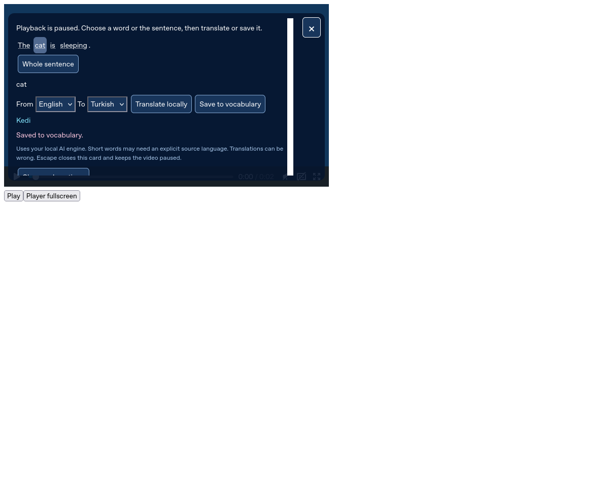

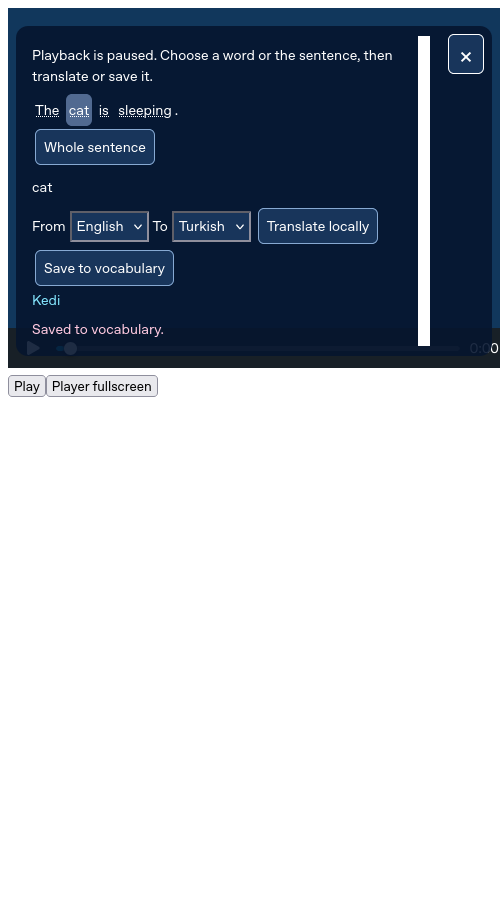

## 0.10.0: yerel kelime defteri ve kayıt sınırları

[Gerçek Firefox raporu](evidence/wordbook-results.json) altı akışı doğrular. Normal popup’tan kelime kaydet ve defteri aç; Türkçe `Işık`/`ışık` araması, düz metin HTML, klavyeyle silme/geri alma ve başka sayfada kaydedilen kelimeyi koruma. Gerçek JSON dosyası önizlemesi yazmaz; açık birleştirme 120 yeni metni ekler, tekrarları atlar, dosyadaki sahte ayar alanını uygulamaz; 50 satırlık sayfalar ve geçersiz/iptal dosyada veri koruma geçer. Tarayıcı gerçek UTF-8 JSON dosyasını indirir; aynı dosyayı seçerek silineni geri getirme, kaynak metinleri korur ve ayar/taslak dışa aktarmaz.

Normal ayar kontrolleriyle TR/EN, koyu/yüksek kontrast, paket OpenDyslexic, %200 arayüz ve bağımsız %140 metin aynı akışta denendi. Dar ekranda yatay taşma olmadı; arama ve ekleme taslağı dil/görünüm değişince korundu ve ana kayıt eylemi çalıştı. Test profili cihaz dili English olduğu için Türkçe aşaması önce gerçek Ayarlar dil seçicisinden başlatılır; ürünün cihaz dilini izleme davranışı değiştirilmedi.

5.000 kayıtlı gerçek dosyadan birleştirme, ekleme/popup/taşan dosyada açık hata ve kayıt/taslak/önizleme koruması geçti; ayarlar listesi yalnız son 50 kaydı önizler. Çeviri modülü normal checkbox’la kapatıldıktan sonra defterde arama/silme/geri alma çalıştı, yeniden açınca kayıtlar korundu ve AI motoru hâlâ yüklenmemişti. Ayrı [video kartı raporu](evidence/caption-card-results.json), aynı sınırda kaydet düğmesinin başarı yerine anlaşılır hata gösterdiğini de doğrular.

Beş ek birim testi; dolu/uzun/yanlış tipte yeni metin ve tekrar kaydı; Unicode/boşluk/eski tekrarları sırasıyla geri alma ve eşzamanlı yeni kelime; atomik dosya birleştirme/yanlış sürüm/kötü kayıt ve ayarları koruma; kapasitesi dolan geri almayı veri kaybetmeden yeniden deneme; kapalı modülde veri erişimi ve web içeriğinin yetkisiz kalmasını kapsar. Video kartı yetki testi silme/geri alma/içe aktarma girişimlerini de reddeder. Çeviri doğruluğunda veya platform/imza kapsamındaki açıklarda iyileşme iddia edilmez.

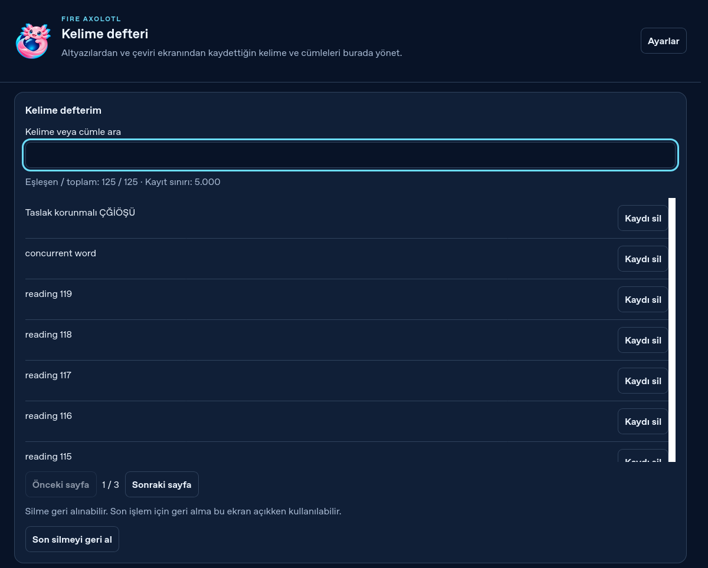

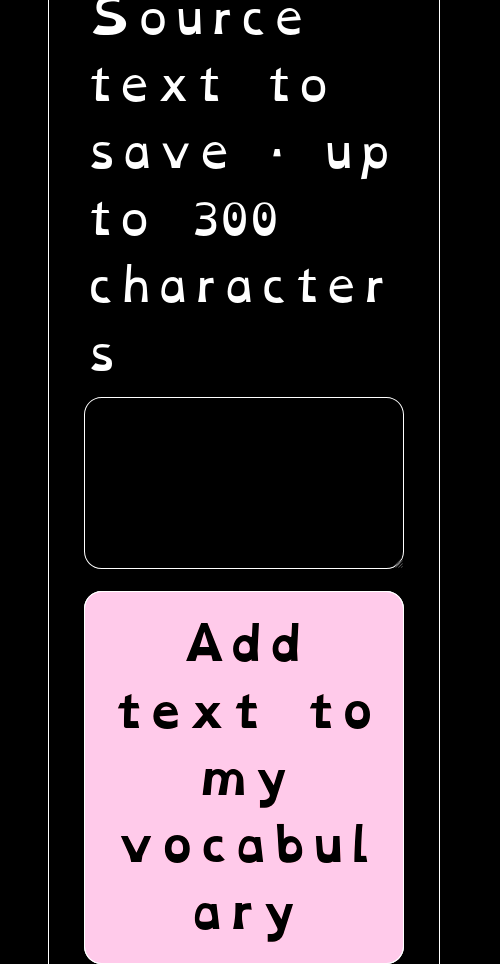

0.10.0’ın ilk uzak koşusu [42847734543](https://github.com/kaansavukduran/fire-axolotl-extension/actions/runs/42847734543), mevcut altyazı gezinme testinin tekrar oynatma başladıktan sonra WebDriver sekme değiştirene kadar geçen sürede videonun dar zaman aralığında kalacağını varsayması nedeniyle durdu. Yeni kelime defteri adımına henüz gelmemişti. Test gerçek medyanın `seeking` olayını kaydederek 0,5 saniye ve gecikmeli 0,7 saniye hedeflerine gidildiğini denetler; sonraki gezinme için duraklatılmış konum açık seçilir. Oynatma hızı, gerçek zaman, video API’si ve uygulama davranışı değiştirilmez; zaman kontrolü atlanmaz. Başarısız koşu korunur.

## 0.11.0: görev paneli, anlaşılır konteynerler ve AI başlangıcı

[Gerçek Firefox raporu](evidence/usability-results.json) altı akışı doğrular. Gerçek araç çubuğu paneli 640 × 580 piksel içinde yatay kesilmeden açılır, Çeviri ilk görünür görevdir ve ana çeviri düğmesi görünür alandadır. Firefox ağı kapatıldıktan sonra ilk paket motor çalışması gerçek “Kedi” çıktısı üretir. Tam sayfa paneli kalıcı bir sekmede açılır; açık kaynak sekmesi seçimi, panel etkinken hız ve seçili metin almayı doğru siteye uygular.

Gerçek bağlantı menüsü aynı bağlantıyı iki kez İş konteynerinde açar. Yerel HTTP sunucusunun gördüğü oturum çerezleri normal hesapla ayrıdır; ikinci İş sekmesi İş hesabını korur. Seçili sayfa metninin menüsünden geçici konteyner açılır; son sekmesi kapanınca yalnız geçici kimlik temizlenir. Firefox’un native sekme menüsü de seçilen kimlikle sayfayı açar. Seçili metin bağlamı ilk denemede menü kapsamına girmiyordu; seçim/görsel/ses/video bağlamları da eklenerek düzeltildi.

Video düğmesi kaynak sekme kimliğini AI ekranına taşır. Başlangıç kılavuzu ve açık düğme paket çevirisini başlatır. Qwen bağlantısı ayrı model indirme ve genel soru kontrollerini açar; kendiliğinden model indirmez. İngilizce arayüz ve dar tam sayfa panelinde yatay taşma yoktur. Mevcut Firefox temasıyla ilgili opt-in değişmemişse her ayar kaydında gereksiz tema sıfırlama yapılmaz; birim testi bunu denetler.

Marionette popup’ın XUL browser’ına normal frame geçişini desteklemez. Test gerçek araç düğmesini açar, gerçek popup DOM’unu yalnız eklentinin getViews arayüzüyle kullanır; görüntü o popup’ın gerçek Firefox sürecinden drawSnapshot ile alınır. Native menüde görünür Firefox öğesinin kendi komutu ve menü kapatma işlemi kullanılır; konteyner API’si, çerezler ve model taklit edilmez. Headless Firefox’taki eski/başka native menüleri kapatmak için normal Escape olayı kullanılır. Önceki otomasyon denemeleri görünmeyen ön yüklenmiş popup’ı veya açık kalmış menüyü seçmişti; bu sonuçlar başarı olarak sayılmaz.

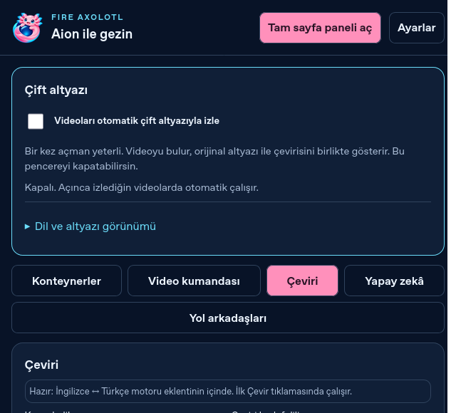

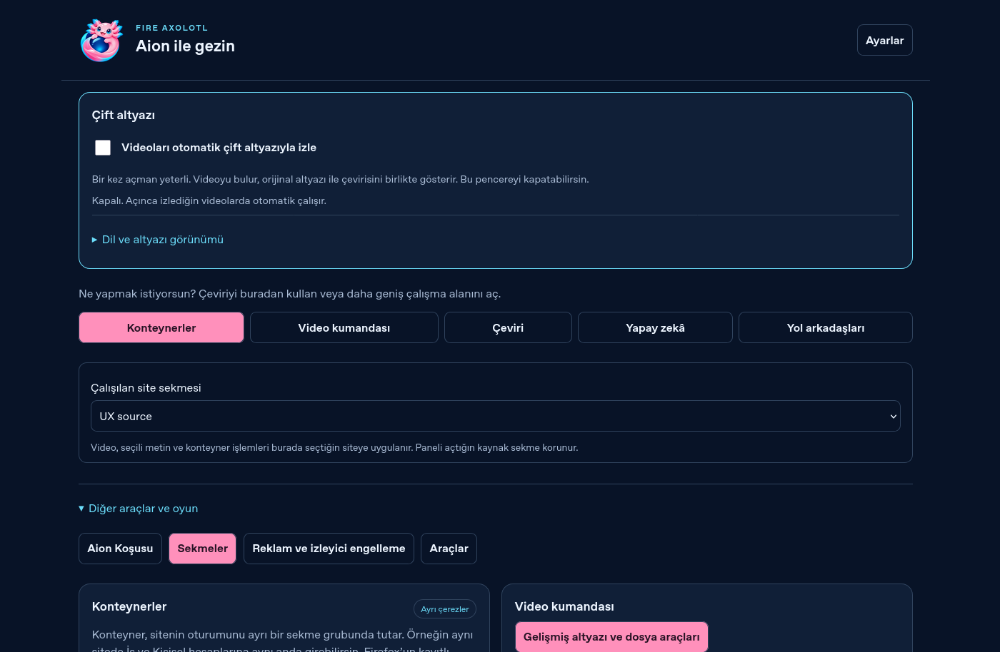

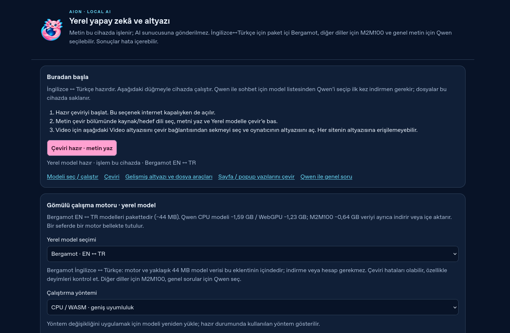

Bu sürüm Qwen’in Türkçe kalitesini, imzalı kalıcı kurulum kapsamını veya native Firefox/DRM sınırlarını değiştirmez.

## 0.12.0: Aion araç çubuğu ve YouTube CC okuyucusu

[Beş gerçek Firefox akışı](evidence/youtube-results.json) şu kapsamı doğrular: uBO’nun gerçek `setIcon`/`setDefaultIcon` çağrılarından sonra iki durumda da native araç simgesi Aion yolunu gösterir. Native kaynak TextTrack olmayan yerel HTTPS oynatıcıda normal video girişinden mevcut kaynak sekme alınır; ilk açışta CC açılır ve gerçek paket Bergamot `The cat is sleeping.` → `Kedi uyuyor.` üretir. Otomatik kaynak dili, oynatıcının verdiği English kodunu kullanır. Özgün ve çeviri native tam ekranda aynı zamanları taşır.

Ayrı normal anahtarlarla yalnız özgün, yalnız çeviri, ikisi gizli ve ikisi görünür geçti. YouTube’un kaynak çizimi Aion açıkken örtülü, durdurunca geri gelir. Boş/değişmiş satırda eski yazı temizlenir. Gerçek modelin bir sonucu testte kontrollü geciktirilmiştir; motor taklit edilmemiştir. Kaynak satır değişince geç gelen kapı çevirisi müze satırına takılmaz ve yeni satır gerçek motorla sırada çevrilir.

Hızlı kapat/açta eski cleanup yeni hedefi veya port kaydını silemez; yeni başlangıç önceki temizlemeyi bekler. Videodaki × aktif oturumu durdurur. SPA video değişimi eski katmanı kaldırır ve açıklamalı hata verir. CC kullanılamıyorsa yeni katman oluşmaz; kaynak/hedef seçimi ve Durdur düğmesi çalışır. English, %200 arayüz + bağımsız %120 metin + OpenDyslexic, 500 px pencere altında yatay taşma yoktur ve ana kontrol çalışır. Aktif kontrol sekmesi kapanınca katman kalkar ve native CC geri gelir. Son test yalnız bu kontrol sayfasının pagehide temizleme olayını engeller; gerçek arka plan port-disconnect temizliği katmanı kaldırır. uBO, kendi portlarını kaydederken sender bilgisini siliyordu ve Aion’un kanal doğrulaması bu nedenle atlanıyordu. Aion’un yaşam döngüsü kanalı artık uBO port işleyicisinden ayrılır. Model/arka plan API’si taklit edilmez.

Firefox disabled TextTrack için `cues=null` verir. Yeni sık canlı yenilemede mevcut native izler hidden modda okunup temizlenir ve önceki moda döner; görünmeyen izde birikme önlenir. Mevcut ana 42 Firefox kontrolü ve paket motorunun 6 çevrimdışı akışı yeniden geçti.

**Canlı hizmet sınırı:** Paylaşılan YouTube bağlantısı denendi. Bu ortamın proxy’si kamu YouTube alan adına HTTP 403 döndürdü. Erişim başka rotayla aşılmadı. Fikstürün `www.youtube.com` adı yalnız izole Firefox profilinde loopback’e çözülür ve rastgele yerel porta bağlanır; yerel CA ve ayrı sunucu sertifikası yalnız bu test için üretilir. TLS doğrulaması açıktır; sandbox ve imza kontrolü kapatılmaz. Gerçek YouTube sayfası, hesap veya o videonun altyazısı indirilmemiştir. Bu sonuç hizmetin bütün arayüz sürümlerini ya da istenen canlı videoyu doğrulamış sayılmaz. Ses yazıya dökülmez, DOM kaynağı tam transkript/VTT değildir.

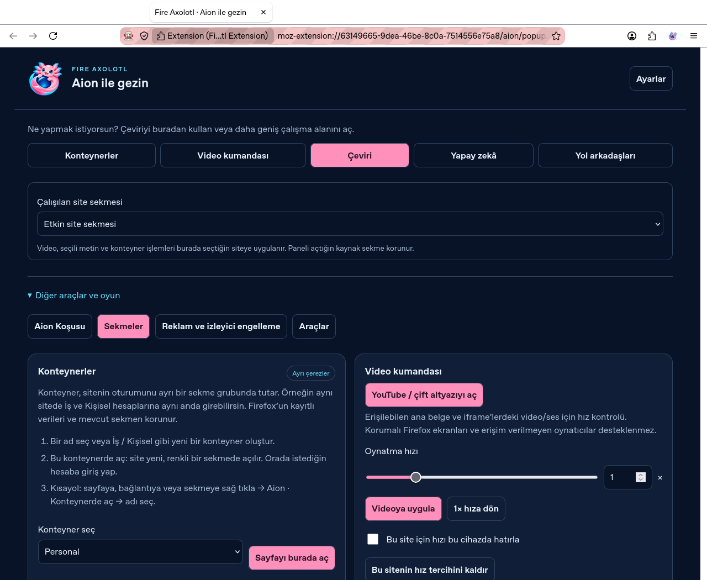

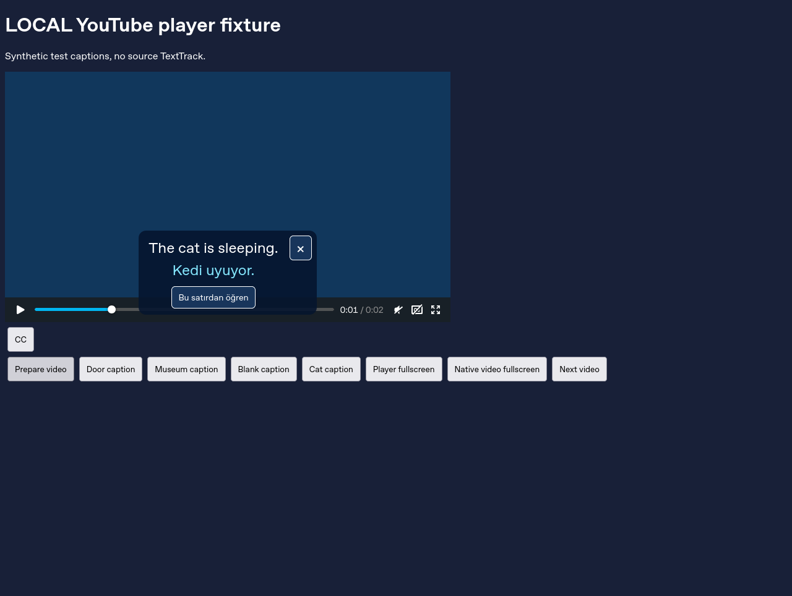

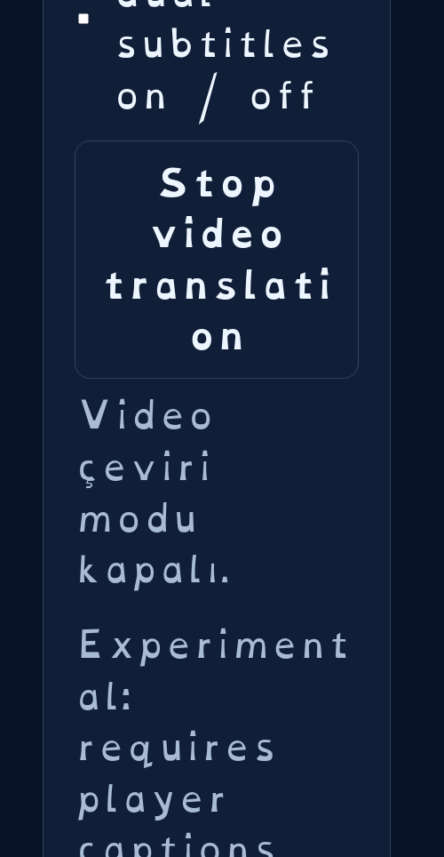

0.12.0’ın ilk uzak koşusu [42888624394](https://github.com/kaansavukduran/fire-axolotl-extension/actions/runs/42888624394), mevcut satır döngüsü testinde başlat düğmesine tıkladıktan hemen sonra dış zamana gitme varsayımı nedeniyle durdu. Daha yavaş frame hazırlığında yeni 1,1 saniye konumu henüz başlatılmamış döngünün kaynağı olabiliyordu. Test artık gerçek `captionLooping` yanıtını ve ilk kaynak satırını bekledikten sonra dışarı seek yapar; 1,45 saniyeyi geçme denetimi korunur. Oynatma zamanı/hızı veya uygulama davranışı değiştirilmez. Başarısız koşu korunur; yeni YouTube testi bu koşuda henüz çalışmamıştı.
